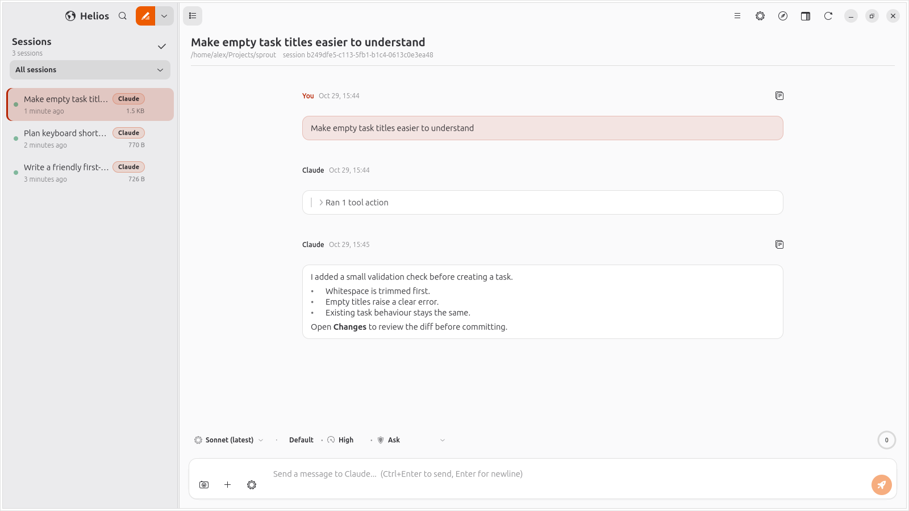

<p align="center">
  
</p>

<h1 align="center">Helios</h1>

<p align="center">
  <strong>Your coding agents, in one Linux desktop.</strong><br>
  A native Linux GUI for Claude Code, OpenAI Codex, Google Antigravity, Muse Code, Kimi Code and OpenRouter, built with GTK4/libadwaita.
</p>

<p align="center">
  <a href="https://norvitech.com"></a>
  <a href="https://github.com/spencernorton/helios/actions/workflows/ci.yml"></a>
  <a href="https://github.com/spencernorton/helios/releases"></a>
  <a href="https://norvitech.com/#install"></a>
  <a href="LICENSE"></a>
  <a href="https://buy.stripe.com/8x26oH2U44f65TRe574wM04"></a>
</p>

<p align="center">
  <picture>
    <source media="(prefers-color-scheme: dark)" srcset="docs/screenshots/overview-dark.png">
    
  </picture>
</p>

<p align="center"><sub>The current Helios interface, captured in light and dark mode with a fictional project and staged agent replies. Watch the narrated demos for the controls and workspace.</sub></p>

Helios is a free, open-source Linux desktop app for developers who use coding
agents. Run Claude Code, OpenAI Codex, Google Antigravity, Muse Code, Kimi
Code and OpenRouter from one native GTK4/libadwaita window, with your
projects, conversations and review tools together. Each provider keeps its
own runtime and account; the controls reflect what that provider supports.

## What it does

**Keep the work in view.** Browse project conversations, follow streaming
answers and tool results, and see which sessions are working or waiting for
you. Pick a model, reasoning effort and permission mode beside the composer;
available choices come from the connected provider.

**Preview and run beside the conversation.** Open local reports and dev
servers in the browser pane, or use the tabbed terminal in the chat's folder.
Supported agents can read, screenshot and interact with browser pages under
per-site consent; Google sessions use their CLI's browser tools.

**Review the changes before they land.** Inspect diffs, stage individual
hunks, send review comments back to the agent, commit, push and open a pull
request. Start a chat in an optional Git worktree to keep its file changes
separate from your main checkout.

**Go back or try another direction.** Rewind restores files from a
checkpoint taken before a message in a Git repository; ignored files and
external effects are outside its coverage. Fork a Claude conversation from a
message, or use native conversation forks where GPT and Kimi advertise them.

**Give a session a goal.** Keep your objective and acceptance checklist
beside the agent's execution plan. Read context and usage where the provider
reports them; metered Claude and GPT sessions and OpenRouter have distinct
spend controls, described in the [user guide](docs/user-guide.md#budgets).

**Use the shortcuts you already know.** Type `/` for agent commands and,
in Claude chats, discovered commands and skills; open the command palette
with `Ctrl+Shift+P`. Helios follows your desktop's light/dark theme and accent
colour, with an optional translucent sidebar.

## Install

### Ubuntu 26.04 — latest release package

For the features described here, install the current GitHub release:

```bash
curl -fLO https://github.com/spencernorton/helios/releases/download/v0.114.4/helios_0.114.4_all.deb &&
curl -fLO https://github.com/spencernorton/helios/releases/download/v0.114.4/SHA256SUMS.txt &&
grep '  helios_0.114.4_all.deb$' SHA256SUMS.txt | sha256sum --check - &&
sudo apt install ./helios_0.114.4_all.deb &&
helios
```

The [Releases page](https://github.com/spencernorton/helios/releases/latest)
has the package, matching source and checksums. The
[quickstart](docs/quickstart.md) includes checksum verification and the first
chat. Packages are built and tested on Ubuntu 26.04; the APT service currently
supports amd64. Other distributions and architectures use the source route.

### Other distributions — run from source

Requirements: Python 3.11+, GTK 4.10+, libadwaita 1.5+, GtkSourceView 5 and
PyGObject with cairo integration. WebKitGTK 6.0 provides the browser pane;
VTE 3.91 provides the terminal. On Debian/Ubuntu:

```bash
sudo apt install python3-gi python3-gi-cairo gir1.2-gtk-4.0 gir1.2-adw-1 gir1.2-gtksource-5 libgtksourceview-5-0 gir1.2-webkit-6.0 gir1.2-vte-3.91 gir1.2-xdp-1.0 gir1.2-xdpgtk4-1.0 git python3-pil
git clone https://github.com/spencernorton/helios.git
cd helios
./scripts/helios
./scripts/install-desktop.sh     # optional: app-grid entry and icon
```

Install equivalent system packages on other distributions. Pillow is needed
by the desktop-entry installer; desktop portal support enables screenshots.
Check `python3 --version` before launching: the source launcher does not
check the Python version. Helios has no macOS or Windows build.

### Ubuntu 26.04 — stable APT updates

```bash
curl -fsSL https://apt.norvitech.com/setup.sh | sudo sh
sudo apt install helios
```

The setup script installs the archive keyring and configures **stable** APT
updates. Stable can lag behind GitHub releases: on 29 October 2026 stable
provides 0.101.0 and the separate opt-in candidate channel provides 0.114.4.
The six-provider and workspace features on this page describe the latest
release. A downloaded newer package does not gain candidate-channel updates
just because the stable repository is configured. See
[installation and update choices](https://norvitech.com/helios/install/).

### Sign in and start a chat

Install only the providers you want. Helios does not bundle their CLIs.
Settings → **Accounts** opens their sign-in flows; Settings → **Providers**
checks model discovery and accepts supported API keys.

| Provider | Runtime and sign-in |
|---|---|
| Claude Code | Install `claude`; sign in with `claude auth login --claudeai` for a Claude account, or use the CLI's supported API setup. |
| OpenAI Codex / GPT | Install `codex`; run `codex login` for ChatGPT. An API key can be entered in Settings → Providers and is stored by Codex. |
| Google / Gemini | Install Antigravity CLI (`agy`), open `agy` and complete Google-account sign-in. [Google setup](docs/google-subscription.md). |
| Muse Code | Install `muse`; run `muse login` for a Meta account, or enter a Meta API key in Settings → Providers. |
| Kimi Code | Install Kimi Code 2.3.2+; run `kimi login` for membership sign-in. [Kimi setup](docs/kimi-subscription.md). |
| OpenRouter | Enter an OpenRouter API key in Settings → Providers; Helios supplies its own agent loop. |

For your first chat, press `Ctrl+Shift+N`, choose a project folder, select a
model and send with `Ctrl+Enter`. New chats otherwise fall back to the most
recent project or your home folder; home-folder chats are read-only. Google
sessions require a project folder. Permission labels and capabilities vary
by provider.

## Documentation

- [Complete user guide](https://norvitech.com/helios/docs/) — searchable setup instructions for every provider, everyday workflows, workspace tools, backups and troubleshooting.
- [Quickstart](docs/quickstart.md) — install, sign in and finish your first task.
- [User guide](docs/user-guide.md) — sessions, permissions, goals, usage, browser, terminal, changes and shortcuts.
- [Google account setup](docs/google-subscription.md) — Antigravity sign-in and provider limits.
- [Kimi membership setup](docs/kimi-subscription.md) — native ACP sign-in, models and supported features.
- [Agent setup](docs/agent-setup.md) — install, configure and verify from a shell; [llms.txt](llms.txt) indexes the docs.
- [Feature walkthrough](https://norvitech.com/helios/features/) and [provider guide](https://norvitech.com/helios/providers/) — the current workbench and its integrations.
- [Narrated demos](https://norvitech.com/helios/demos/) — watch the app with captions and readable transcripts.
- [Changelog](CHANGELOG.md) — changes by release.

## Where your data lives

| Path | Purpose |
|---|---|
| `~/.claude/projects/<encoded-cwd>/*.jsonl` | Claude transcripts and Helios display mirrors for other providers; native provider stores remain authoritative for their own context |
| `~/.claude/projects/<encoded-cwd>/memory/` | Notes edited in the Claude memory pane, with atomic saves and backups |
| `~/.helios/` | UI settings, Work ledger, goals, logs, permissions, checkpoints and other application state |
| `~/.helios/openrouter.key` | Optional OpenRouter key, mode 0600 |
| `~/.helios/browser/` | The embedded browser's separate profile, including its cookies and sign-ins |
| `~/.helios/media/` | Saved pasted images, browser snapshots and displayed media |
| `~/.helios/backups/` | Rotating memory-editor backups |
| `~/.helios/session-archive/` | Conversations moved out of the sidebar after inactivity |

`HELIOS_STATE_DIR` relocates only part of the state; use a separate `HOME`
for a fully isolated trial. Helios sends no telemetry; prompts, selected
context and tool results go to your chosen providers, whose data-use
settings apply. See [SECURITY.md](SECURITY.md) for the trust model.

## Contributing and support

- Questions, bugs and ideas: [Issues](https://github.com/spencernorton/helios/issues/new/choose) and [Discussions](https://github.com/spencernorton/helios/discussions).
- Security reports: [private vulnerability reporting](https://github.com/spencernorton/helios/security/advisories/new). There is no e-mail address; that is deliberate. Read [SECURITY.md](SECURITY.md).
- Read [CONTRIBUTING.md](CONTRIBUTING.md) before proposing a change. Pull requests are reviewed and squash-merged here; accepted changes ship in a tagged release.
- If Helios helps you, [support its development](https://buy.stripe.com/8x26oH2U44f65TRe574wM04).

## Development

CI checks the backend on Python 3.11 and 3.13, then the complete native suite
and an installed Debian package on Ubuntu 26.04. For the backend lane:

```bash
mkdir -p /tmp/helios-nogtk
printf 'raise ModuleNotFoundError("gtk hidden")\n' > /tmp/helios-nogtk/gi.py
PYTHONPATH=/tmp/helios-nogtk python3 -m pytest -p no:cacheprovider
```

For native tests, install the source dependencies plus `python3-pytest xvfb
xauth dbus` and run:

```bash
GSK_RENDERER=cairo dbus-run-session -- xvfb-run -a python3 -m pytest -p no:cacheprovider
```

The test fixtures isolate their state. For a manual application trial use
`HOME="$(mktemp -d)" ./scripts/helios`. Follow
[CONTRIBUTING.md](CONTRIBUTING.md) for full setup and the installed-package
acceptance check. Lint with the version CI pins:

```bash
ruff check .                    # ruff 0.15.20
```

Build the Debian package on Linux with `scripts/build.sh [outdir]`; it needs
`build-essential debhelper dh-python pybuild-plugin-pyproject python3-all
python3-pil python3-setuptools`, and runs `lintian` when available.

## Licence

[MIT](LICENSE) © Spencer Norton

---

<p align="center">
  <a href="https://norvitech.com"></a>
</p>

<p align="center">
  <a href="https://github.com/spencernorton/helios">Helios</a> ·
  <a href="https://github.com/spencernorton/DH-Waypoint">DH-Waypoint</a> ·
  <a href="https://github.com/spencernorton/armiger">Armiger</a> ·
  <a href="https://github.com/spencernorton/xnote">XNote</a> ·
  <a href="https://github.com/spencernorton/xnote-placement">XNote Placement</a> ·
  <a href="https://github.com/spencernorton/snipsnap">SnipSnap</a> ·
  <a href="https://github.com/spencernorton/conductor">Conductor</a> ·
  <a href="https://github.com/spencernorton/norvi-os">NorviOS</a> ·
  <a href="https://github.com/spencernorton/indigo">Indigo</a> ·
  <a href="https://github.com/spencernorton/roadtrack">Road Track</a> ·
  <a href="https://norvitech.com">norvitech.com</a>
</p>
